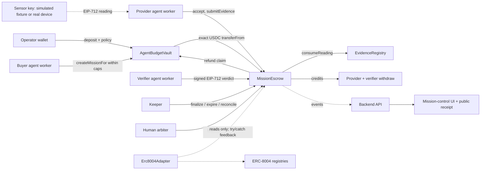

# Architecture

## Components

- `contracts/MissionEscrow.sol`: holds USDC per mission. States: Funded, Assigned, Submitted, Accepted/Rejected (verdict recorded, challenge window open), Challenged, Settled, Expired. Created and Funded are one atomic step (the USDC is pulled in the same transaction). Payouts are credits that providers and the verifier withdraw themselves. Refunds are claimable per mission.
- `contracts/AgentBudgetVault.sol`: operator deposits once and authorises one executor with per-mission, net total and daily caps, an expiry, an escrow allowlist (limited to escrows fixed at vault construction), pause, and reclaim of uncommitted funds. The executor can only move money into allowlisted escrows via `createMissionFor`.
- `contracts/EvidenceRegistry.sol`: sensor signers bound to providers (the device countersigns the binding). Validates EIP-712 readings: mission, tile, unit, freshness, single-use nonce, bound signer.
- `contracts/Erc8004Adapter.sol`: optional identity binding and outcome feedback. Isolated: the escrow never calls it, feedback calls are wrapped in try/catch.
- `server/`: Bun backend. `agents/buyer.ts` (quotes, ranking, vault policy check, funding), `agents/provider.ts` (signed quotes, accept, evidence bundle, withdraw), `agents/verifier.ts` (deterministic checks, signed verdict), `pipeline.ts` (state machine and keeper), `store.ts` (atomic JSON state, content-addressed evidence, idempotent jobs), `api.ts` (read views), `http.ts` (routes), `auth.ts` (single-use wallet-signed challenges) and `authz.ts` (role checks), `index.ts` (server entry).
- `src/`: React UI. The field grid, timeline, bids, evidence inspector, audit feed, wallets panel, vault setup (wagmi) and the receipt page.

## Source of truth

Money truth is the chain. The backend `data/` directory is a cache of agent working state (quotes, decisions, rationale, evidence files). Reads are public; writes need a wallet-signed request (see the threat model). Mission stage in the UI is recomputed from confirmed onchain status on every poll; a mission is never shown as paid until the escrow status is Settled with outcome ProviderPaid and the transactions have successful receipts.

## Money handling on Arc

All app money uses the ERC-20 interface of USDC at `0x3600000000000000000000000000000000000000` with 6 decimals, as integer base units. The 18-decimal native view (gas) is never added to it or displayed as a separate balance. Reads are by `balanceOf`; amounts are parsed and formatted with `src/onchain-money.ts`.

## Idempotency and restarts

Every agent step is a job keyed by (mission, step). A finished job never runs again. A job that recorded a transaction hash resumes by awaiting that hash. Every step also re-reads chain state first and skips if the effect already happened. Funding after a crash searches recent escrow events for an existing mission with the same objective hash and adopts it instead of paying twice. Failed jobs back off and stop after four attempts, and the failure is visible in the audit trail.

## Evidence bundles

The public bundle (reading, signature, signer, provenance, masked serial, digest of the private body) is serialised as canonical JSON (sorted keys, integers only) and stored under its keccak256 hash. That hash is submitted onchain as `evidenceHash`; the EIP-712 digest of the signed reading is stored as `readingCommitment`. The raw device payload and operator notes are stored privately and committed by digest. The receipt page recomputes both in the browser.

## Verdict flow

The verifier signs an EIP-712 `Verdict` (mission, evidence hash, decision, reason hash, expiry, nonce) bound to chain id and escrow address. Anyone may relay it; the escrow checks the signature (ERC-1271 aware), the nonce, expiry and the evidence hash. Decisions: accept, reject, or escalate to a human arbiter. Settlement table for timeouts and arbiter rulings is in `docs/THREAT_MODEL.md`.
